# Инструкция оператора

Программа читает показания газовых счётчиков по фото контролёров. Что она
не смогла прочитать сама, вы разбираете в окне. За месяц PowerShell не нужен.
Снимки экрана сделаны на выдуманных данных.

## Как поставить и открыть программу

Программа приходит архивом **«GMR X.Y.Z.zip»**. Распакуйте его,
например в `D:\` — получится папка «GMR». Python и интернет не
нужны. В папке:

- **«GMR.exe»** — программа: окно оператора, обработку фото она
  запускает сама;
- **«ПРОЧТИ.txt»** — коротко, как поставить;
- **«Инструкция оператора.html»** — эта инструкция (откроется в браузере);
- «ВЕРСИЯ.txt» — версия программы, `_internal` — служебная папка, не трогать.

Откройте «GMR.exe» и в меню **«Справка» → «Ярлык на рабочем
столе»** — дальше открывайте программу ярлыком **«GMR»**. Там же,
в «Справке», — эта инструкция и версия программы («О программе»).

Новая версия — новый архив: распакуйте его поверх старой папки. Папки
месяцев лежат отдельно и не трогаются.

До версии 1.3.0 программа называлась «GMR Оператор» (папка и ярлык с этим
именем). Распакуйте «GMR» рядом со старой папкой — ваше имя и месяц
программа возьмёт оттуда сама. Сделайте новый ярлык («Справка» → «Ярлык на
рабочем столе»); старые папку «GMR Оператор» и ярлык можно удалить.

Окно одно и открывается сразу на весь экран: посередине — «Вы вошли как
…» и месяц. **Enter** — продолжить, «Сменить пользователя или месяц» —
другое имя или папка месяца (тут же, на этой карточке).

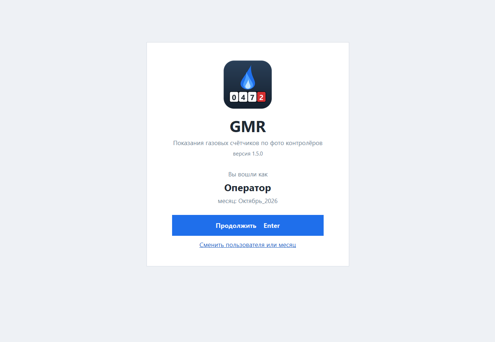

При первом запуске на той же карточке — **ваше имя и папка месяца**:
«Выбрать папку…» — месяц уже есть, «Новый месяц…» — создать его из таблицы
компании (как ниже). Ошибка (не ввели имя, папка — не месяц) — красной
строкой здесь же.

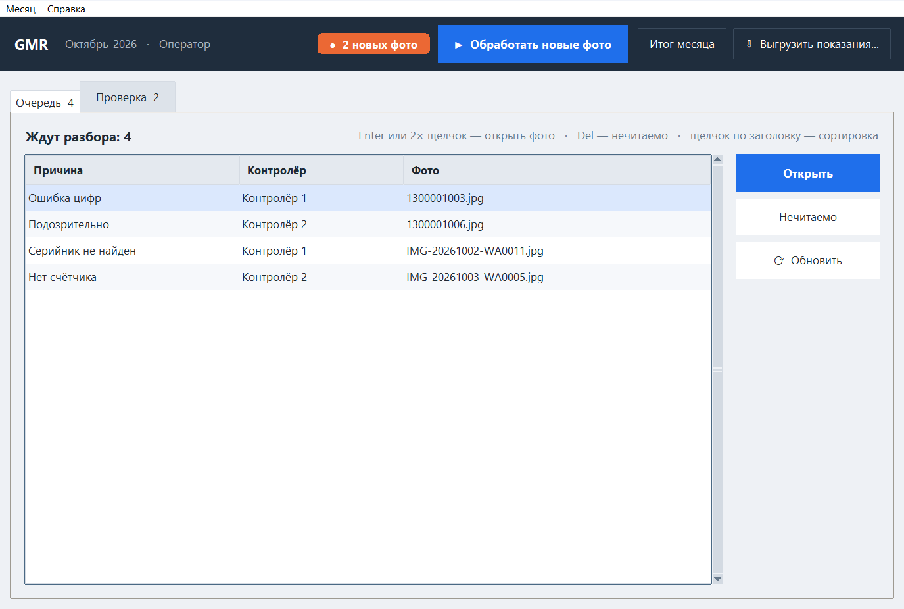

## В начале месяца

1. Меню **«Месяц» → «Новый месяц…»**.
2. **Перетащите таблицу компании** (`.xls`, `.xlsx` или `.csv`, как её
   прислали) с рабочего стола или из проводника в поле посреди окна. Или
   щёлкните по полю — откроется проводник, выберите таблицу там.

   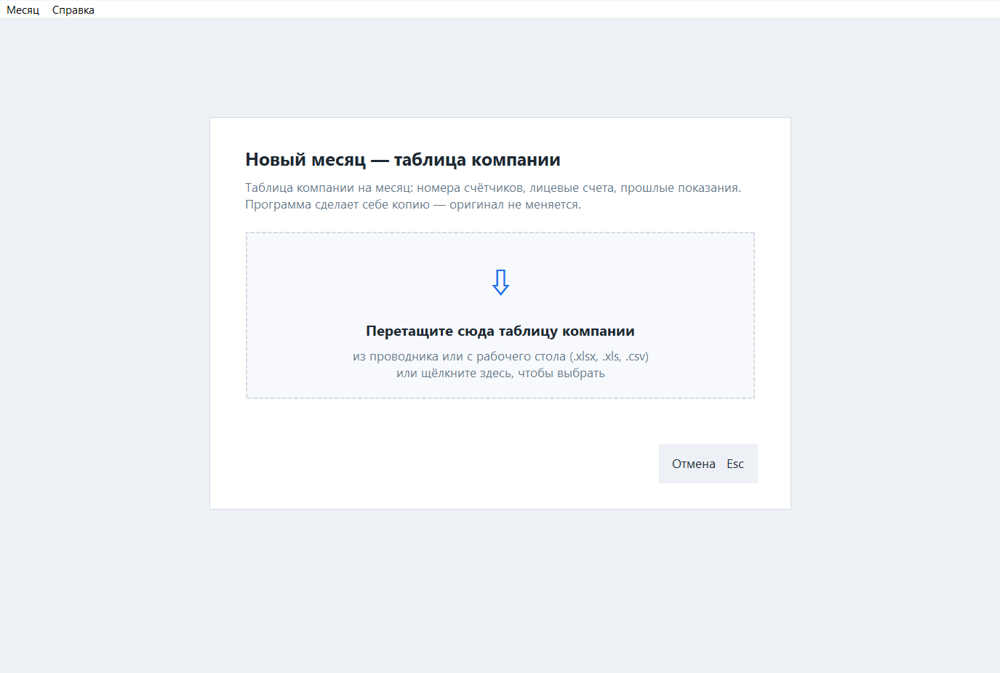

3. Окно, как при «Сохранить как», предложит имя папки — название месяца,
   например `Октябрь_2026`, рядом с прошлым месяцем. Нажмите «Сохранить»:
   папку программа создаст сама.
4. Окно покажет **настройки распознавания** — они уже заполнены как в
   прошлом месяце. Обычно просто нажмите «Дальше». На вкладке «Обычные» —
   что программа читает сама (лицевой счёт по надписи маркером, надписи
   поверх фото), с какой разницы с прошлым показанием фото считается
   **подозрительным** (по умолчанию — больше 10 000 м³) и кнопка «Вернуть
   стандартные настройки». Вкладка
   **«Расширенные»** — для владельца программы: что ставить вместо
   пропущенной цифры, как прощать неуверенные последние цифры, уверенность
   каждой модели. Не уверены — не меняйте.
5. Окно покажет отчёт загрузки: сколько абонентов, какие номера счётчиков
   повторяются и т. п. Нажмите «Закрыть» — окно уже работает с новым месяцем.

Если в таблице уже есть показания, окно спросит, очистить ли их. **«Да»** —
месяц начинается без показаний, программа прочитает все фото; **«Нет»** —
эти показания считаются уже записанными. Оригинал таблицы не меняется
(копия — в папке месяца).

В папке месяца видно только **`фото\`** и **`показания.xlsx`** (и другие
выгрузки) — всё служебное программа прячет (скрытые файлы и папки), чтобы
контролёров ничего не путало. Увидеть его можно в проводнике: «Вид» →
«Показать» → «Скрытые элементы».

Если рядом с таблицей лежит старый лог программы, окно спросит, переносить
ли его. Обычно отвечайте **«Нет»**.

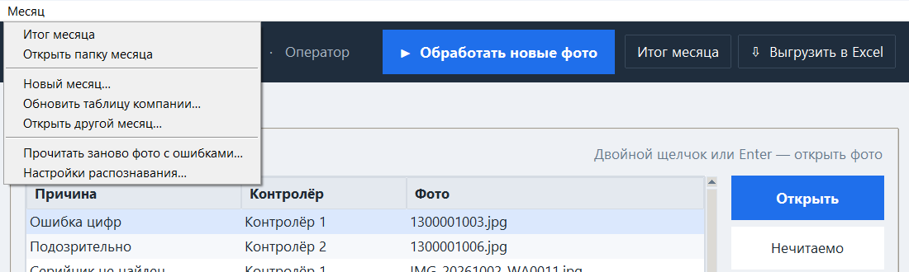

## Каждый день

1. **Добавьте новые фото.** Проще всего — **перетащите папку с фото
   контролёра в окно программы** (или кнопка **«＋ Добавить фото…»**,
   Ctrl+O, и папку — в поле). Программа спросит, чьи это фото: имя папки
   она подставит сама, если у контролёра уже есть папка — узнает её. Enter
   — «Добавить».
   - Фото **копируются** в папку месяца `фото\<контролёр>\`, оригиналы
     остаются, где были.
   - У контролёра уже есть папка — новые фото **добавятся к ней**; те же
     самые фото второй раз не копируются, другое фото с тем же именем
     получит имя «… (2)».
   - Можно перетащить и папку, в которой папки контролёров (`Аюб\`,
     `Фатима Я\`…) — каждая добавится к своему.

   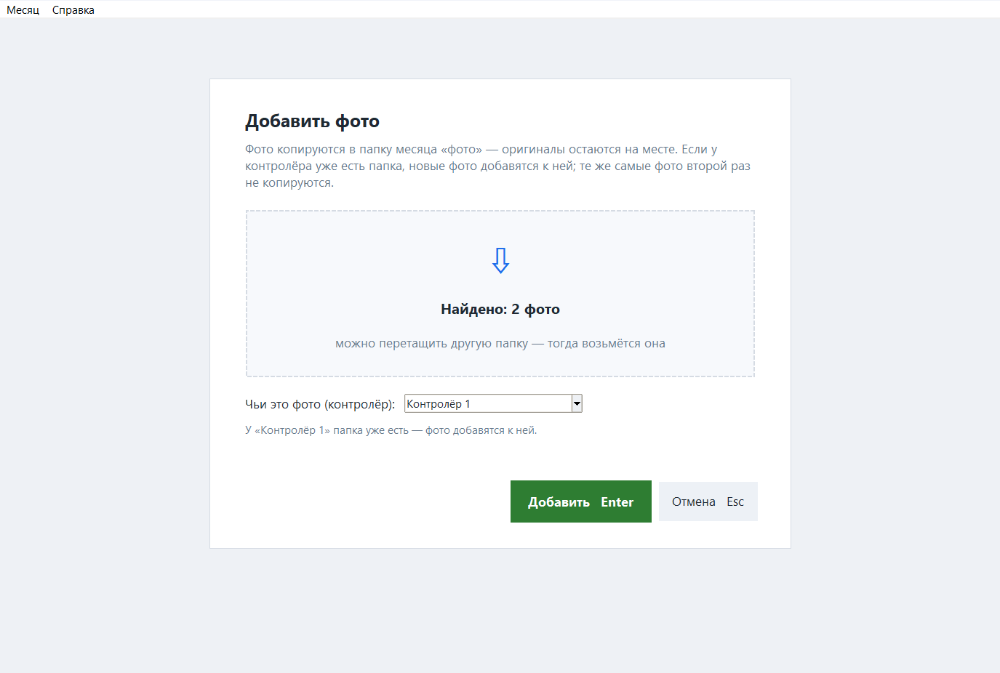

   По-старому тоже можно: положить фото в папку месяца `фото\<контролёр>\`
   («Месяц» → «Открыть папку месяца»).
   - У каждого контролёра своя папка: `фото\Аюб\`, `фото\Сулиман С\`…
   - Прямо в `фото\` фото не кладите — программа попросит разложить их по
     папкам.
   - Старые фото не удаляйте и не переносите: программа сама помнит, что
     уже разобрано, и второй раз их не читает.
2. **Нажмите «▶ Обработать новые фото».** Рядом с кнопкой оранжевый значок
   **«● 3 новых фото»** — программа сама замечает фото, которые вы положили
   в папки контролёров (проверяет раз в 10 секунд). Значка нет — новых фото
   нет. Щелчок по значку — то же, что кнопка. В окне появится ход
   обработки: шаги (запуск → модели → чтение фото → итог), проценты,
   «Обработано N из M новых фото», сколько идёт, сколько примерно осталось
   и во сколько закончится. В начале программа до минуты загружает модели —
   это нормально, точка рядом мигает, пока работа идёт. Пока она
   идёт, разбирать фото нельзя (кнопки вверху выключены). «Остановить» —
   программа дочитает текущее фото и закончит; остальные прочитает
   следующий запуск.

   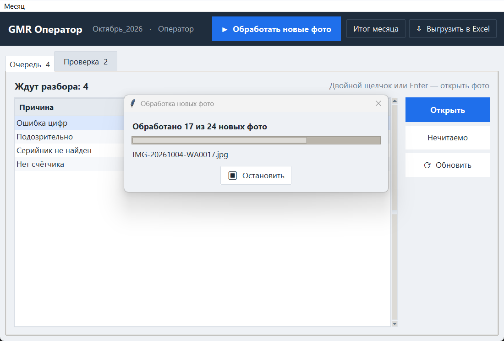

   В конце там же — итог: сколько новых фото, сколько программа записала
   сама, сколько ушло в очередь. **Enter — «Разобрать очередь»**, Esc — к
   спискам, «Подробный отчёт» — весь отчёт обработки.

   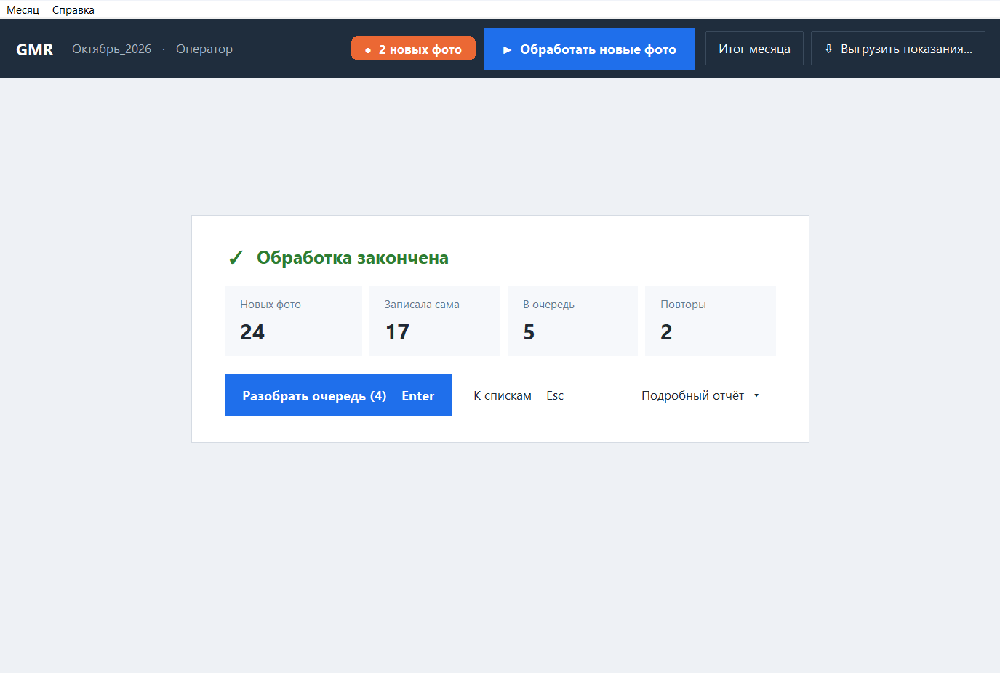

3. **Разберите очередь** на вкладке «Очередь» (рядом — сколько фото ждут).
   Это фото, которые программа не смогла прочитать сама. В столбце
   «Контролёр» видно, чьё фото. Двойной щелчок по строке или Enter открывает
   фото (двойной щелчок по заголовку столбца только сортирует).

   **Щелчок по заголовку столбца — сортировка**, как в проводнике Windows:
   первый щелчок по числу или дате — от больших к меньшим, по тексту — по
   алфавиту; второй — наоборот. Стрелка у заголовка показывает, по чему
   отсортировано. В этом же порядке идут фото одно за другим на экране
   разбора. После перезапуска программы порядок — снова обычный.

   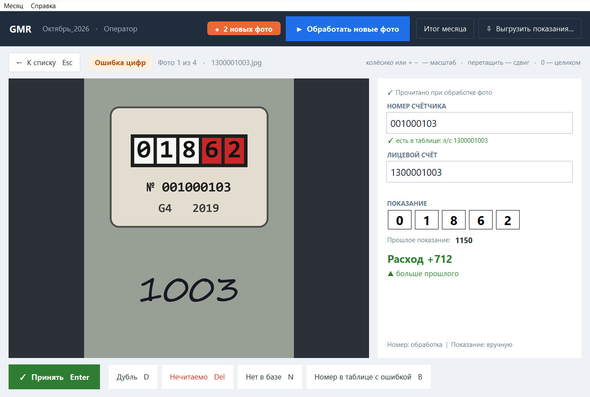

   Проверьте номер счётчика, лицевой счёт и 5 цифр показания. Под номером
   зелёным «✓ есть в таблице» — номер нашёлся; справа видно прошлое
   показание и расход. Нажмите:
   - **«Принять» [Enter]** — показание верное. Если у счёта уже есть
     показание, окно покажет его и спросит «Заменить?».
   - **«Дубль» [D]** — повтор счётчика, который уже прочитан.
   - **«Нечитаемо» [Del]** — по фото показание не прочитать.
   - **«Нет в базе» [N]** — счётчика нет в таблице компании. Если компания
     потом добавит его в таблицу, программа прочитает фото сама. Если окно
     нашло абонента в таблице, оно попросит вписать номер с фото (номер из
     таблицы не подойдёт: такое фото — «Принять»).
   - **«Номер в таблице с ошибкой» [B]** — на фото номер верный, а в таблице
     компании опечатка. Номер исправится в базе месяца, показание
     запишется, номер попадёт в список для компании `db_serial_fix.csv`.

   Под номером счётчика оранжевая строка «⚠ … но счёт не с участка
   контролёра» — номер привёл к счёту другого участка (у контролёра свой код
   в начале счёта: 1300, 0429…). Проверьте номер на фото: чаще всего это
   ошибка в одной цифре.

   Буквы D, N, B, E работают и в русской раскладке. После каждого действия
   сразу открывается следующее фото. «← К списку» [Esc] — вернуться к
   списку.

   **Фото:** колёсико мыши — крупнее или мельче в том месте, где мышь;
   клавиши **+** и **−** — то же к середине; **0** или двойной щелчок —
   снова фото целиком; перетащить мышью — сдвинуть.
4. Время от времени — вкладка **«Проверка»**: фото, которые программа
   прочитала сама. Стрелка в столбце «Расход»: **зелёная ▲** — показание
   больше прошлого, **красная ▼** — меньше. «Разница» — показание минус
   прошлое (со знаком: «-12» — меньше на 12). Удобно отсортировать по
   «Разнице» и посмотреть самые большие и отрицательные.
   «Верно» [Enter], «Исправить» [E] или «Пропустить» [→]; [←] — вернуться
   к предыдущему фото. Esc при исправлении — отменить исправление.

   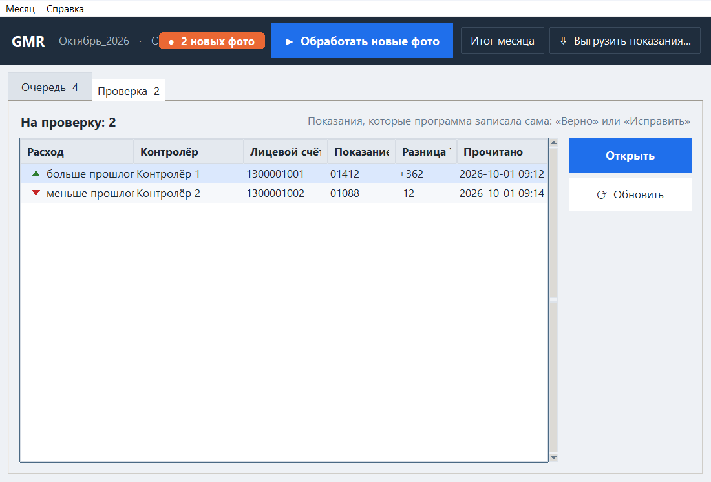

   Вверху — **«На проверке: N»**: сколько фото осталось; после «Верно» —
   на одно меньше (то же число — на вкладке «Проверка»).

   **Каждый месяц проверьте хотя бы 30–50 фото** — по ним программа
   считает, как часто она ошибается (это видно в «Итоге месяца»).
   Фото на «Проверке» идут вперемешку, поэтому неважно, какие именно:
   проверяйте подряд сверху. Неверное показание — «Исправить» [E]: так
   ошибка попадёт в подсчёт. Не видно цифр — «Пропустить» [→].
   Для подсчёта проверяйте **без сортировки** (как список открылся): если
   проверять только самые большие разницы, процент ошибок выйдет выше
   настоящего.

   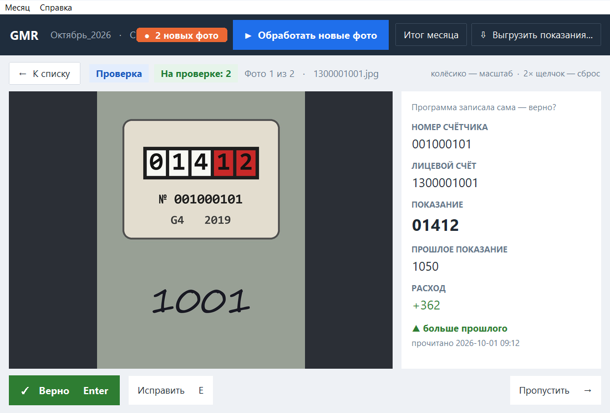

## Горячие клавиши

Все клавиши — в меню **«Справка» → «Горячие клавиши»**. Главные:

| Клавиша | Что делает |
|---|---|
| F1 | эта инструкция |
| F5 | обновить списки (и проверить новые фото) |
| Ctrl+O | добавить фото (или перетащите папку в окно) |
| Ctrl+I | итог месяца |
| Ctrl+E | выгрузить показания |
| Ctrl+Tab | другая вкладка: «Очередь» / «Проверка» |
| Enter | открыть фото; на фото — «Принять» / «Верно» |
| Del | «Нечитаемо» — и в списке «Очереди», и на фото |
| Esc | назад к списку |

Сообщения вроде «Все фото в очереди разобраны» появляются внизу окна и
сами исчезают через несколько секунд — нажимать «ОК» не нужно.

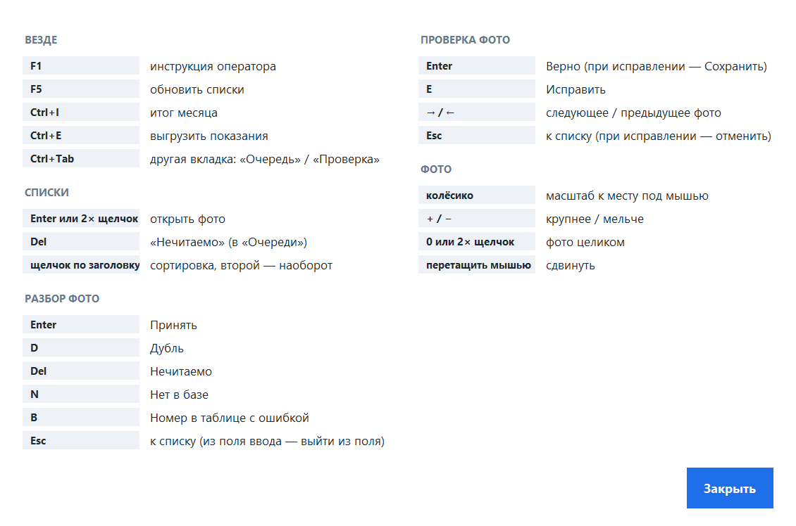

## Настройки распознавания

Меню **«Месяц» → «Настройки распознавания…»**. Действуют со следующей
обработки фото этого месяца.

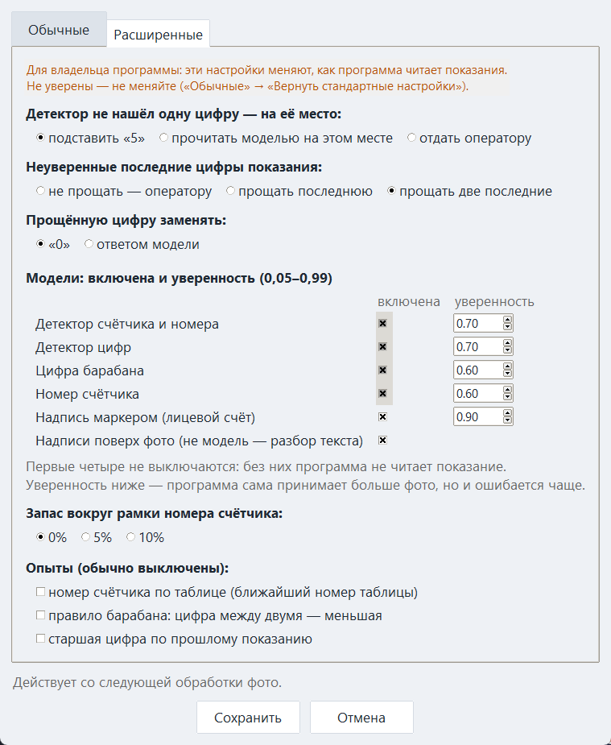

## Если компания прислала обновлённую таблицу

Меню **«Месяц» → «Обновить таблицу компании…»** и перетащите новый файл в
поле (или щёлкните по полю и выберите его).
Показания, которые уже записаны, сохраняются. Новые абоненты добавляются,
пропавшие помечаются «нет в таблице».

## В конце месяца

1. **«Итог месяца»** — экран с числами и полосами:
   - вверху — абонентов в таблице, с показанием, без показания, сколько фото
     ждут оператора и **процент ошибок программы**;
   - «Кто записал показания» — программа (синий), оператор (оранжевый),
     было в таблице (бирюзовый), без показания (серый);
   - «Фото месяца» — сколько фото программа прочла сама, сколько отдала вам;
   - «Проверка программы» — процент ошибок по фото, которые вы проверили на
     «Проверке», и где он вероятно лежит (розовая полоса: при малом числе
     проверенных она широкая), сколько неверных примерно среди всех
     показаний программы;
   - «Очередь оператора» — что вы решили по фото из «Очереди».

   Наведите мышь на полосу — всплывёт число. **«Текстом (TXT)»** открывает
   тот же итог текстом (файл `итог_месяца.txt` — скрытый, в папке месяца),
   «Без показаний (CSV)» — список абонентов без показания. Esc — назад.

   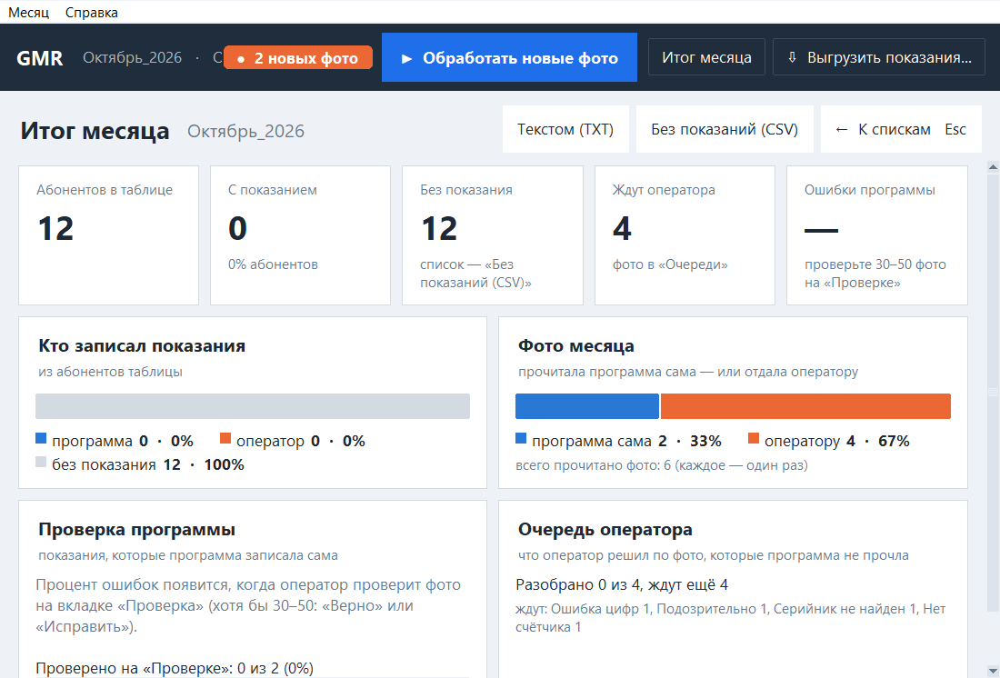

2. Отдайте компании файл с показаниями из папки месяца. Кнопка
   **«⇩ Выгрузить показания…»** спросит, в каком виде:
   - **Excel (.xlsx)** — обычный;
   - **Excel 97–2003 (.xls)** — для старых программ;
   - **CSV (.csv)** — текст с «;», открывается везде;
   - **OpenDocument (.ods)** — LibreOffice, «Мой Офис».

   Файл появится в папке месяца: `показания.xls`, `показания.csv`… —
   кнопки «Открыть файл» и «Открыть папку» там же. Выбор запоминается.
   `показания.xlsx` обновляется всегда: после каждой обработки, при
   выгрузке и при закрытии окна. Список абонентов без показания — кнопка
   «Без показаний (CSV)» в «Итоге месяца».
3. Следующий месяц — снова «Месяц» → «Новый месяц…» и новая папка.

## Если что-то не так

| Что видно | Что делать |
|---|---|
| «Файл открыт в Excel: показания.xlsx» | Закройте файл в Excel и нажмите «Повторить» (или «Выгрузить показания…» ещё раз). Показания при этом не теряются — они в базе месяца |
| «Обработка не удалась» и текст про фото без папки контролёра | В `фото\` лежат фото без папки. Разложите их по папкам контролёров и снова «Обработать новые фото» |
| В итоге обработки «⚠ Не взяты …» | Эти файлы программа не читает (не `.jpg`/`.png` или папка внутри папки контролёра). Если это фото — сохраните его как `.jpg` |
| «Ошибка программы» | Сообщите владельцу программы и версию — она в заголовке окна (например «GMR 1.3.0»). Подробности — в файле `program2.log` в папке программы (если окно открыто ярлыком) |
| После замены модели нужно перечитать старые фото с ошибками | Меню «Месяц» → «Прочитать заново фото с ошибками…» |
